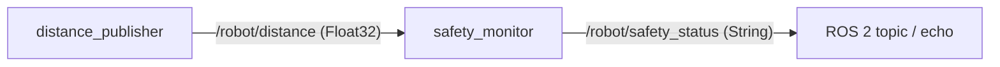
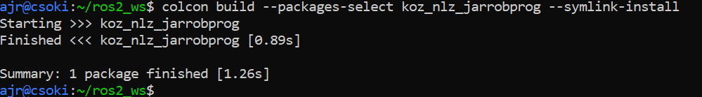
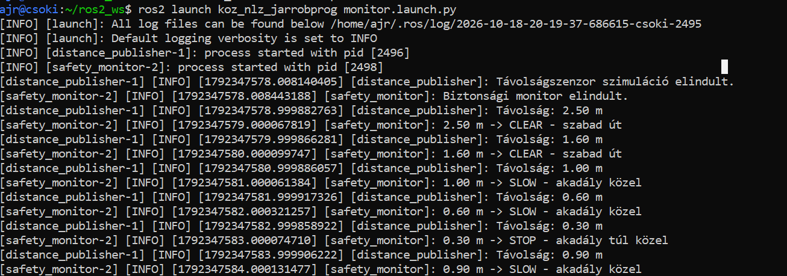
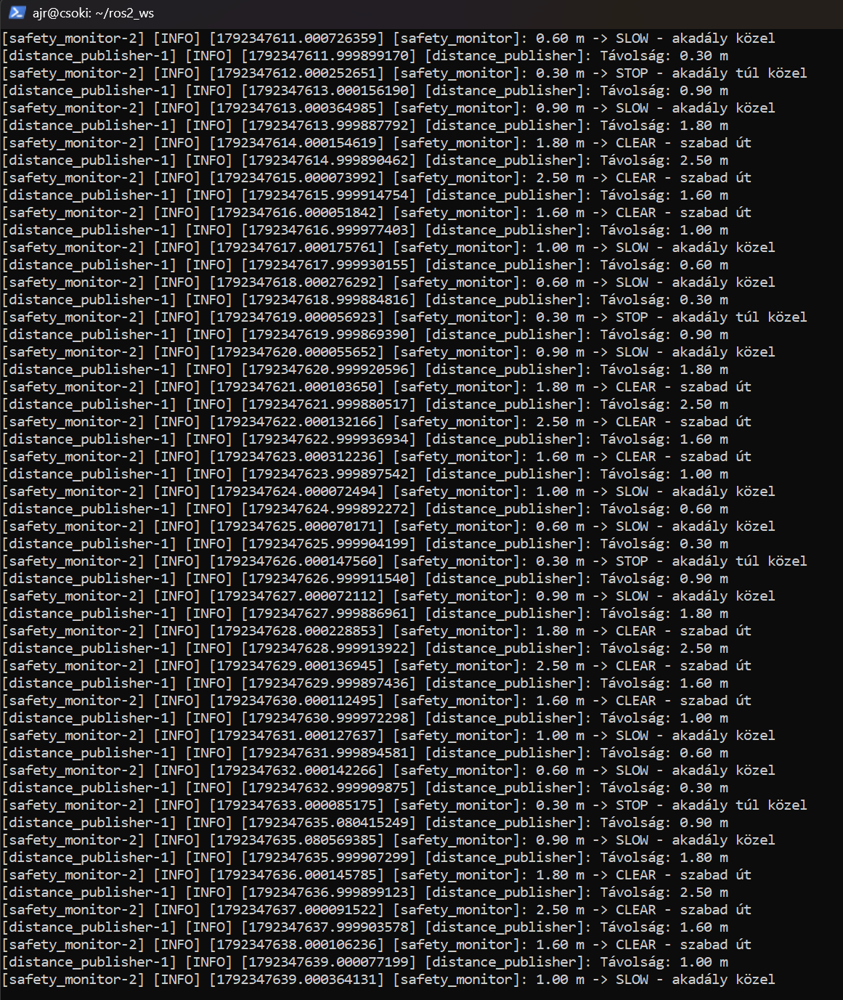
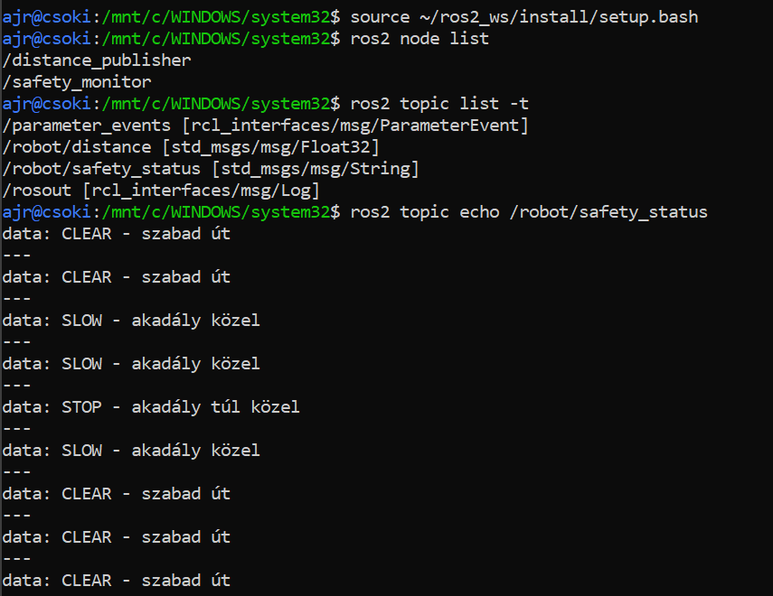

# ROS 2 robot-akadályfigyelő – kis beadandó

**Repository:** [JedlikKB/koz_nlz_jarrobprog](https://github.com/JedlikKB/koz_nlz_jarrobprog)  
**Környezet:** ROS 2 Humble, Ubuntu 22.04, WSL 2, Python 3

## Rövid leírás

A program valódi robot nélkül szemlélteti a ROS 2 publisher–subscriber kommunikációját. A `distance_publisher` másodpercenként különböző (előre rögzített) távolságértékeket küld a `/robot/distance` topicra. A `safety_monitor` ezeket fogadja, majd a mért távolsághoz tartozó állapotot a `/robot/safety_status` topicra publikálja.

**Állapotok:** `STOP` ha a távolság < 0,5 m; `SLOW` ha 0,5 m ≤ távolság < 1,2 m; `CLEAR` ha ≥ 1,2 m.

## Node–topic kapcsolatok

| Node | Feladat | Topic | Üzenettípus |
| --- | --- | --- | --- |
| `distance_publisher` | Publisher | `/robot/distance` | `std_msgs/msg/Float32` |
| `safety_monitor` | Subscriber | `/robot/distance` | `std_msgs/msg/Float32` |
| `safety_monitor` | Publisher | `/robot/safety_status` | `std_msgs/msg/String` |



## Fordítás (build)

A repositoryt a `~/ros2_ws/src/koz_nlz_jarrobprog` könyvtárba kell klónozni, majd:

```bash
source /opt/ros/humble/setup.bash
cd ~/ros2_ws
colcon build --packages-select koz_nlz_jarrobprog --symlink-install
source install/setup.bash
```

## Indítás

```bash
source /opt/ros/humble/setup.bash
source ~/ros2_ws/install/setup.bash
ros2 launch koz_nlz_jarrobprog monitor.launch.py
```

Második terminálban (ugyanazon WSL környezetben):

```bash
source /opt/ros/humble/setup.bash
source ~/ros2_ws/install/setup.bash
ros2 node list
ros2 topic list
ros2 topic echo /robot/safety_status
```

Az első terminálban rendszeres mérések és figyelmeztetések látszanak; a másodikban a `STOP`, `SLOW`, `CLEAR` állapotok jelennek meg. A program leállítása: `Ctrl+C`.

## Példa kimenet

```text
[distance_publisher]: Távolság: 0.30 m
[safety_monitor]: 0.30 m -> STOP - akadály túl közel
[distance_publisher]: Távolság: 1.80 m
[safety_monitor]: 1.80 m -> CLEAR - szabad út
```

Ez illusztráció, a ténylegesen futó programról külön képernyőképet kell készíteni.

## Képernyőképek









## Források

- [SZE – Kis beadandó követelmények](https://sze-info.github.io/ajr/feleves_beadando/kisbeadando/)
- [SZE – ROS 2 Python csomagsablon](https://github.com/sze-info/ros2_py_template)
